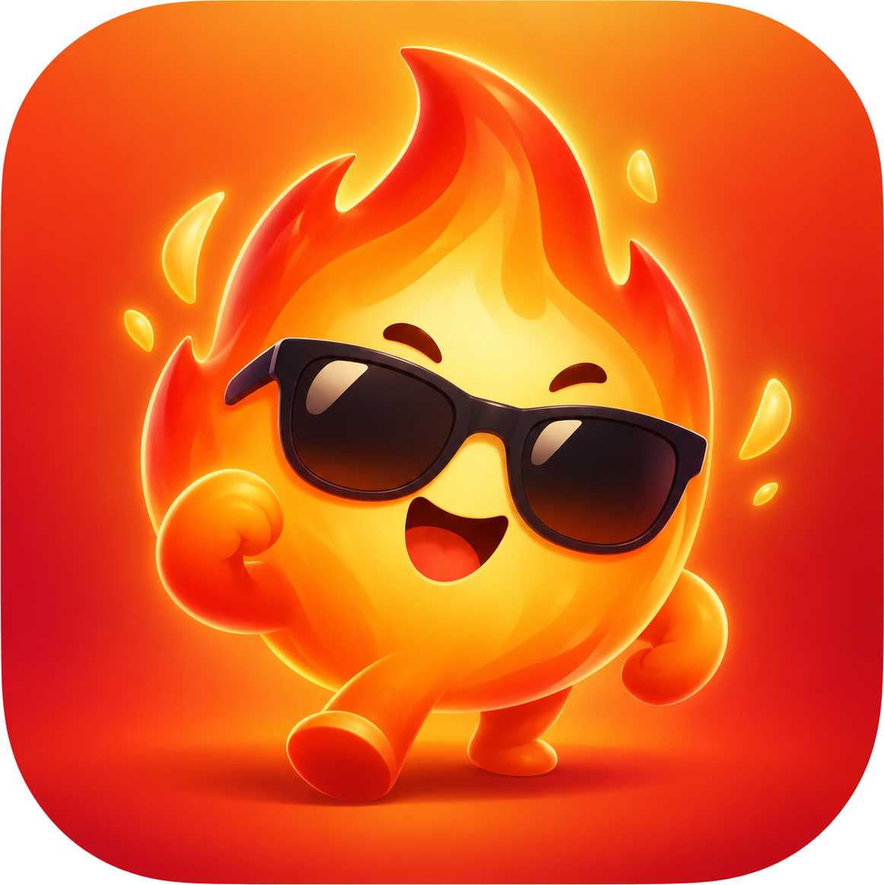
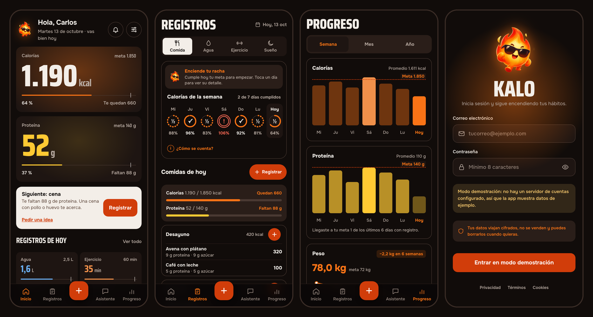
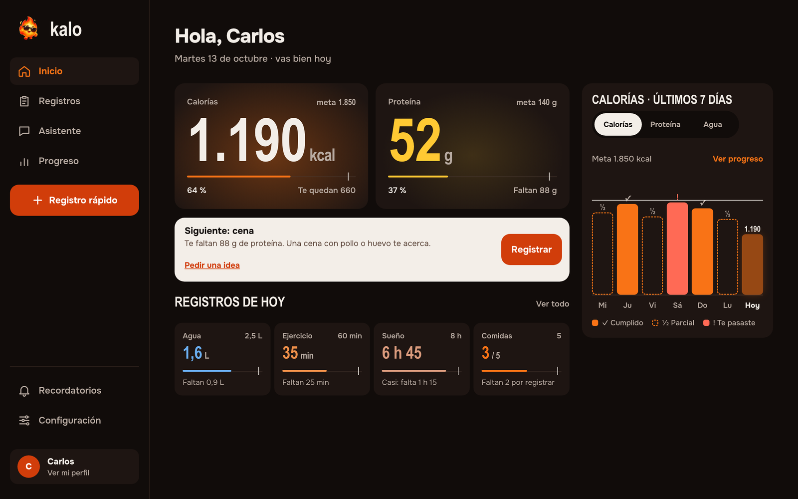
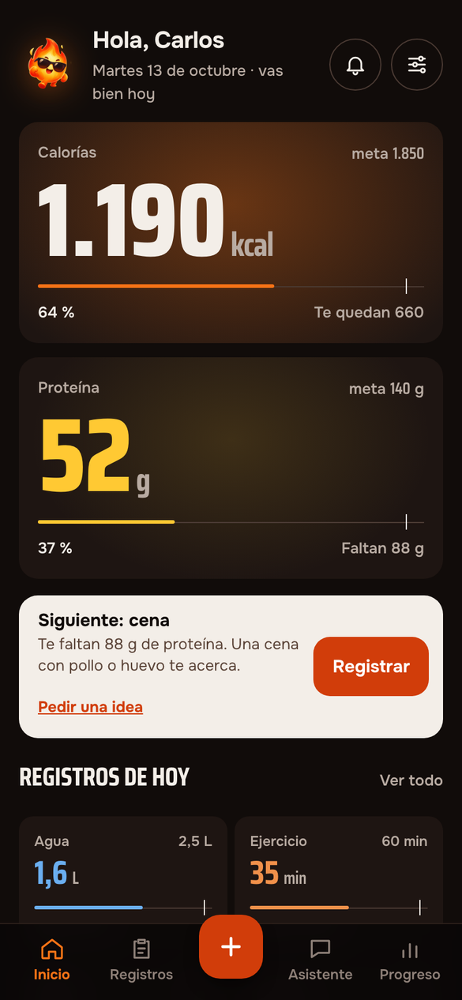
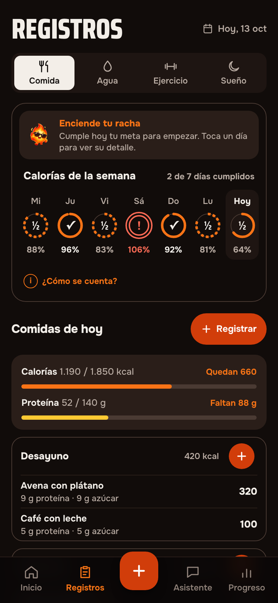
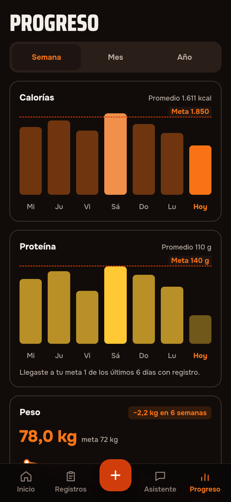
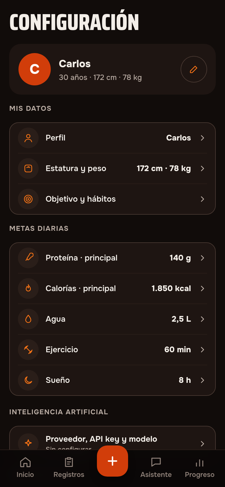

<p align="center">
  
</p>

<h1 align="center">Kalo</h1>

<p align="center">
  <strong>Nutrición y hábitos con IA para quien entrena.</strong><br />
  Registra lo que comes con una foto, el agua, el ejercicio, el sueño y el peso, y sigue dos metas: calorías y proteína.
</p>

<p align="center">
  
</p>

## Qué hace

- **Dos números mandan.** Calorías y proteína a tamaño de marcador, con una luz detrás que crece conforme te acercas a la meta.
- **Registro en segundos.** Foto y la IA estima calorías, proteína, azúcar y grasa (puedes corregirla antes de guardar), o a mano. Agua, ejercicio, sueño, siestas y peso.
- **Asistente nutriólogo.** Conversa con tus metas y tus registros del día como contexto, y registra lo que te sugiere con un toque. No sustituye el consejo médico.
- **Progreso.** Semana con un anillo por día (✓ cumplido, ½ parcial, ! te pasaste), gráficas de calorías, proteína y peso, y rachas.
- **Recordatorios** en el navegador o por correo.
- **Tu IA, tu clave.** Anthropic, OpenAI o Google con tu propia API key, que se guarda cifrada en tu dispositivo y nunca pasa por nuestros servidores.
- **Tus datos son tuyos.** Descárgalos o elimina la cuenta desde Configuración.

<p align="center">
  
</p>

| Inicio | Registros | Progreso | Configuración |
|---|---|---|---|
|  |  |  |  |

Las capturas usan los datos de ejemplo del modo demostración.

## Diseño: «Sala de estudio»

Un estudio de entrenamiento en penumbra: fondos cálidos casi negros, números en Saira Condensed, interfaz en Onest y una sola regla de color (rojo brasa para actuar, naranja para calorías, amarillo para proteína). La luz es un dato y el estado se lee por la forma, no solo por el color.

- [Guía de diseño](docs/rediseno/guia.md) · [instrucciones de implementación](docs/rediseno/implementacion.md) · [propuesta interactiva](docs/rediseno/pantallas/propuesta.html)
- Maquetas de la propuesta en [`docs/rediseno/pantallas/`](docs/rediseno/pantallas/).

## Seguridad y privacidad

- Cabeceras estrictas en producción: CSP sin `unsafe-inline`, HSTS, `frame-ancestors 'none'`, COOP/CORP, `Permissions-Policy` restrictiva. Fuentes y recursos autoalojados.
- Supabase con **RLS en todas las tablas**, sin permisos para el rol anónimo y permisos por columna.
- Contraseñas de 8 caracteres o más con letras y números, confirmación de correo, freno de intentos y CAPTCHA opcional.
- Sin cookies, analítica ni publicidad. Política de [privacidad](web/src/features/legal/PrivacidadPage.tsx), [términos](web/src/features/legal/TerminosPage.tsx) y [cookies](web/src/features/legal/CookiesPage.tsx) dentro de la app, con consentimiento explícito para los datos de salud.
- gitleaks en cada commit y en CI, `npm audit` y Dependabot.

Detalle en [docs/tecnica/seguridad.md](docs/tecnica/seguridad.md). Para informar de una vulnerabilidad, lee [SECURITY.md](SECURITY.md).

## Stack

| Parte | Tecnología |
|---|---|
| Web | React 19, Vite, TypeScript, Tailwind CSS 4, React Router |
| Datos y cuentas | Supabase (Auth + Postgres con RLS, Edge Function para el correo) |
| IA | Anthropic, OpenAI o Google desde el navegador, con la clave del usuario |
| Móvil | Flutter (en construcción) |
| Despliegue | Vercel (web) y Supabase |

## Estructura

| Carpeta | Contenido |
|---|---|
| `web/` | App web (móvil y escritorio) |
| `mobile/` | App móvil en Flutter |
| `supabase/` | Configuración local, migraciones y funciones |
| `docs/` | Avance, documentación técnica, guía de diseño y capturas |
| `design/` | Diseño de referencia original (estructura de pantallas) |
| `assets/` | Mascota y logotipo |

## Probarlo en local

Requisito: Docker Desktop.

```bash
docker compose up --build web
```

Abre <http://localhost:5173>. Sin configurar nada arranca en **modo demostración**, con datos de ejemplo. Para el build de producción con sus cabeceras de seguridad:

```bash
docker compose --profile preview up --build web-preview
```

Abre <http://localhost:8080>. Cuentas reales en local con Supabase y el resto de tareas: [docs/tecnica/entorno-local.md](docs/tecnica/entorno-local.md).

Sin Docker (Node 24):

```bash
cd web
npm install
npm run dev
```

## Desplegar

Vercel para la web y Supabase para datos y cuentas, sin dejar ninguna configuración personal en el repositorio: [docs/tecnica/despliegue.md](docs/tecnica/despliegue.md).

## Estado

| Parte | Estado |
|---|---|
| Web | Completa: onboarding, registros, IA, asistente, progreso, recordatorios, configuración, políticas y control de datos |
| Móvil | Pendiente |

[Hoja de ruta](docs/avance/hoja-de-ruta.md) · [bitácora](docs/avance/bitacora.md) · [decisiones](docs/tecnica/decisiones/)

## Contribuir

El repositorio es público. Activa el escaneo de secretos una vez por clon:

```bash
brew install gitleaks
git config core.hooksPath .githooks
```

Antes de dar algo por terminado en `web/`: `npm run lint`, `npm run typecheck`, `npm test` y `npm run build`.
